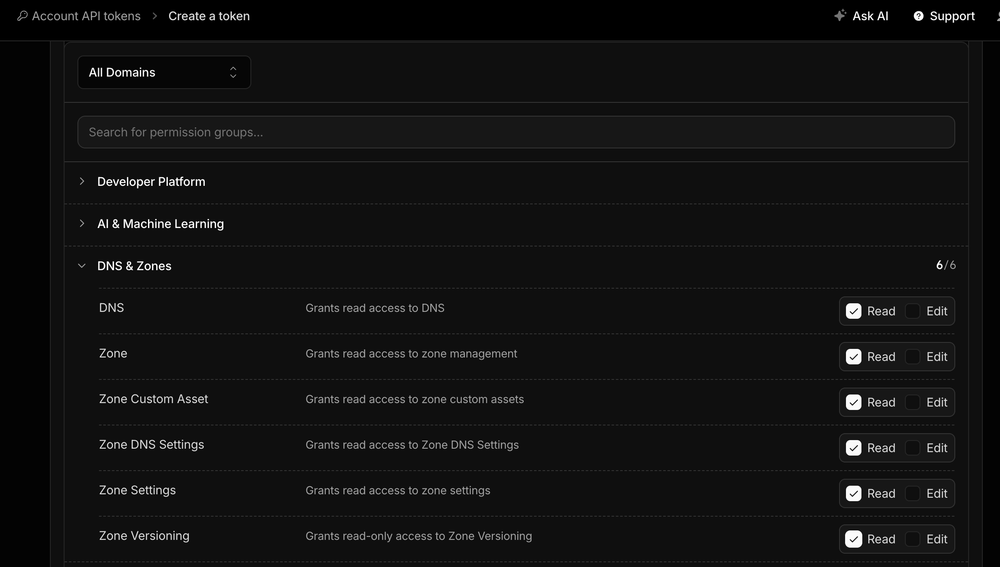

<p align="center">
  
</p>

# Cloudflare Backup

[](https://github.com/mylesagnew/cloudflare-backup/actions/workflows/shellcheck.yml)
[](https://github.com/mylesagnew/cloudflare-backup/releases/latest)
[](LICENSE)


A bash script that uses the Cloudflare API to export and back up DNS records for all zones in your account. Records are saved as timestamped `.txt` files in a local `/domains` directory.

---

## Features

- Automatically fetches **all zones** in your Cloudflare account (handles pagination)
- Exports DNS records for every domain in BIND-compatible format
- Saves each export as `domainname_YYYYMMDD_HHMMSS.txt` for easy versioning
- Reads credentials from a `.env` file — no secrets hardcoded in the script
- Minimal dependencies: `bash`, `curl`, and `jq`

---

## Prerequisites

| Tool | Purpose |
|------|---------|
| `bash` | Script runtime |
| `curl` | API requests to Cloudflare |
| `jq` | JSON parsing |

Install `jq` if needed:

```bash
# macOS
brew install jq

# Ubuntu / Debian
sudo apt-get install jq

# RHEL / CentOS
sudo yum install jq
```

---

## Setup

### 1. Clone the repository

```bash
git clone https://github.com/mylesagnew/cloudflare-backup.git
cd cloudflare-backup
```

### 2. Configure credentials

Copy the example file, lock down its permissions, and add your token:

```bash
cp .env.example .env
chmod 600 .env
```

```bash
CLOUDFLARE_API_TOKEN=your_api_token_here
```

`.env` is listed in `.gitignore`, so it won't be committed.

> **Creating the token:**  
> Cloudflare Dashboard → My Profile → API Tokens → Create Token → **Create Custom Token**  
> Permissions (read-only is enough, so don't grant Edit):
> - **Zone → Zone → Read**
> - **Zone → DNS → Read**
>
> Zone Resources: **Include → All zones** (or only the zones you want to back up).  
> Optionally restrict the token to your backup host's IP with **Client IP Address Filtering**, and set a TTL.



### 3. Make the script executable

```bash
chmod +x cf-dns-backup.sh
```

---

## Usage

```bash
./cf-dns-backup.sh
```

The script will:

1. Load credentials from `.env`
2. Fetch all zones (domains) from your Cloudflare account
3. Export DNS records for each domain
4. Write files to `./domains/` with timestamps

**Example output:**

```
Using .env file
Getting List of domains from Cloudflare
=======================================
Fetching batch of 5 DNS records ...
Fetched 5 domains.
Writing domain DNS files
Exported DNS records for domain: example.com
Exported DNS records for domain: mysite.org
Domain DNS records complete. Please check the /domains directory for your files
```

**Example files created:**

```
domains/
├── example.com_20240315_143022.txt
└── mysite.org_20240315_143023.txt
```

---

## File Structure

```
cloudflare-backup/
├── cf-dns-backup.sh   # Main backup script
├── .env.example       # Template — copy to .env
├── .env               # Your Cloudflare token (git-ignored)
├── domains/           # Output directory (created automatically)
└── README.md
```

---

## Automating with Cron

Run daily backups at 2am:

```bash
crontab -e
```

```cron
0 2 * * * /path/to/cloudflare-backup/cf-dns-backup.sh >> /var/log/cf-backup.log 2>&1
```

---

## Security Notes

- **Never commit `.env`**. It is git-ignored; keep it at `chmod 600`.
- Use a scoped **API Token** with only `Zone:Read` and `DNS:Read`. Never use the Global API Key.
- The script runs from its own directory, so the cron entry works from any working directory.
- Exports contain your full DNS layout (including internal hostnames). Store `domains/` on access-controlled storage.
- Report vulnerabilities privately; see [SECURITY.md](SECURITY.md).

---

## License

[GPL-3.0](LICENSE) © Myles Agnew
